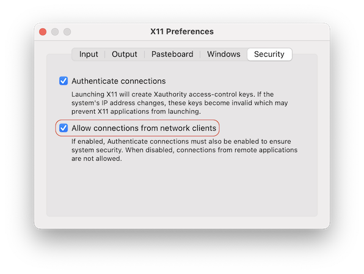

# Running Arm Virtual Hardware FVPs on macOS

This repository runs Linux Arm Virtual Hardware FVPs on macOS with either
[Docker Desktop](https://docs.docker.com/desktop/) or
[Apple Container](https://github.com/apple/container). The generated model
commands remain available on the macOS host. The
[runtime specification](docs/runtime-spec.md) records the shared contract.

## Prerequisites

Install and start one runtime:

- Docker Desktop on an Intel or Apple silicon Mac; check it with `docker info`.
- Apple Container on an Apple silicon Mac running macOS 26 or later; start and
  check it with:

```sh
container system start
container system status
```

The FVPs also require an Arm user-based license. The wrapper maps the host's
`~/.armlm` cache into the container at the same path and runs as the host user.

## Clone the repo

Open a terminal and set the working directory where to store the Fast Model wrapper to. Then run:

```sh
git clone https://github.com/Arm-Examples/FVPs-on-Mac.git
cd FVPs-on-Mac
```

This creates and enters the `FVPs-on-Mac` directory.

## Build the image and model wrappers

This checkout is configured to download and build the official Fast Models
11.32.23 release from `https://artifacts.tools.arm.com/avh/11.32.23/`.
The build selects the Linux archive for the host architecture and verifies its
published SHA-256 checksum.

Run the build script once to create the image and populate `bin/` with model wrappers:

```sh
./build.sh
```

If both runtimes are installed, `build.sh` asks which one to use and saves the
choice in the local `.fvp-runtime` file. Model wrappers, the license utility,
and VS Code use that choice without prompting. If only one CLI is installed,
it is selected automatically. To switch later, run `FVP_RUNTIME=docker ./build.sh`
or `FVP_RUNTIME=container ./build.sh`; setup saves the new choice. For a single
model or license command, `FVP_RUNTIME` overrides the saved choice temporarily.

Docker and Apple Container keep separate images; building `fvp:11.32.23` in one
does not install it in the other.

The generated `bin/` entries link to `fvp.sh`. Check a model:

```sh
./bin/FVP_MPS2_Cortex-M3 --version
```

The GitHub workflow lints the scripts and Containerfile and builds the Docker
image on Linux. Apple Container runtime checks require an Apple silicon Mac.

## Expose models to local environment

Add this checkout's `bin/` directory to `PATH`:

```sh
export PATH="$PATH:$(pwd)/bin"
```

Add the export to `~/.zshrc` if you want it in new shells. VS Code must also
inherit this `PATH` for CMSIS-Debugger to find the model wrappers.

## [XQuartz](https://www.xquartz.org/) setup for FVP GUI (optional)

Install XQuartz and enable **Allow connections from network clients** in its
Security settings. Docker uses `docker.for.mac.host.internal` by default.
For Apple Container, pass a host IPv4 address reachable from the VM, for example
the address of your active network interface:

```sh
FVP_Corstone_SSE-300_Ethos-U55 --display-ip "$(ipconfig getifaddr en0)"
```

`--display-ip` sets `DISPLAY=<address>:0` inside the VM. Set `FVP_DISPLAY_IP`
to avoid passing the option each time. XQuartz must allow the VM's connection;
GUI access depends on the host network and XQuartz access settings. The wrapper
uses TCP for X11 and does not mount the macOS X11 socket into Linux.
For an authenticated XQuartz connection, set `FVP_XAUTHORITY` to a readable
Xauthority file under `FVP_MOUNT_DIR` or `~/.armlm`; the wrapper passes its path
to the container as `XAUTHORITY`.



## Run Models

Once the setup has been completed one can run Fast Models as they are installed natively.

For VIO scripts that read keyboard buttons, launch the model from a terminal
(including VS Code's integrated Terminal). The wrapper attaches container stdin
and a TTY when its own input and output are terminals, so keys such as `0`–`7`
reach the model. A launch without a terminal still runs without keyboard input;
the VS Code Debug Console is not the model's stdin.

Some restrictions still apply:

- By default, your home directory is mounted into the selected runtime at the same
  path. Application images, configuration files, and the working directory must
  be inside that mount. Use `FVP_MOUNT_DIR` for a project elsewhere.

- Fast Models require an activated User Based License. The license cache stored in `~/.armlm` on the host machine
  is mapped into the VM. Activate or inspect it with `bin/armlm`.

- Apple Container's default DNS did not resolve Ubuntu package hosts on one
  tested Mac. This wrapper supplies `1.1.1.1` to builds and runs. Set
  `FVP_CONTAINER_DNS` to another resolver, or to an empty string to use the
  Container default. This setting does not change Docker's DNS.

> [!NOTE]
> - If you do not wish to use the GUI, disable it with `fvp_mps2.mps2_visualisation.disable-visualisation=1` in the FVP configuration text file.
> - If you are using a UART and want to redirect to the Terminal, add `fvp_mps2.UART0.out_file=-` to the FVP configuration text file.
> - If you want to disable the Telnet session, add `fvp_mps2.telnetterminal0.start_telnet=0` to the FVP configuration text file.
> - Depending on your model, the prefix `fvp_mps2` might be different!

## CMSIS-Debugger integration

This checkout extends the wrapper to support the CMSIS-Debugger VS Code
extension through the `GDBServer.so` plugin included in the FVP package.

The resulting connection paths are:

```text
CMSIS-Debugger     -> 127.0.0.1:<gdb-port>  -> selected runtime -> GDBServer.so -> FVP target
CMSIS UART client  -> 127.0.0.1:<uart-port> -> selected runtime -> telnetterminal<n>
```

CMSIS-Debugger can start any generated FVP wrapper through a `gdbtarget`
configuration and pass the plugin path of `GDBServer.so` through the macOS
`AVH_FVP_PLUGINS` environment variable. The following generic launch.json pattern shows
the relevant settings:

```jsonc
"target": {
    "server": "<FVP-wrapper-name>",
    "serverParameters": [
        "-D",
        "--plugin",
        "${env:AVH_FVP_PLUGINS}/GDBServer.so",
        "-C",
        "GDBServer.port=<gdb-port>",
        "-C",
        "GDBServer.allow_remote=1",
        "-C",
        "GDBServer.shutdown_on_disconnect=1",
        "-a",
        "<path-to-application-image>"
    ],
    "port": "<gdb-port>",
    "serverStartupDelay": 5000,
    "uart": {
        "socketPort": "<uart-port>",
        "eolCharacter": "CRLF"
    }
}
```

Set the value for `gdb-port`, `path-to-application-image`, `uart-port`.

VS Code expands `${env:AVH_FVP_PLUGINS}` in the macOS process before the
runtime wrapper starts. The `ENV AVH_FVP_PLUGINS` instruction in the image does
not set this macOS variable. To use the plugin bundled with the active FVP
image, set the host variable to its in-container directory:

```sh
export AVH_FVP_PLUGINS=/opt/avh-fvp/plugins
```

Although `/opt/avh-fvp/plugins` is not a macOS directory, the expanded string
is forwarded as an FVP argument and becomes valid inside the container.

It is important to disable any Fast Models selection in vcpkg-configuration.json of your CMSIS Solution project. Otherwise, the environment setting for the `GDBServer.so` plugin will be overwritten.

The example launch.json uses a 5000 ms startup delay to allow the runtime
and model to start before the debugger connects. Adjust it if startup takes
longer on your Mac. The integrated UART client uses raw mode with CRLF line
endings.

### Runtime cleanup and port reuse

`GDBServer.shutdown_on_disconnect=1` requests graceful plugin shutdown. When VS Code stops or interrupts the server
process, the wrapper's traps identify and remove the exact container created by
that invocation. This prevents a stopped debug session from leaving a container
that still owns the configured GDB or UART port and blocks the next session.

During a live session, inspect instances in the selected runtime:

```sh
container list
container inspect <container-id>
# Or with Docker:
docker ps
docker inspect <container-id>
```

### FVP UART redirect
If you need to redirect e.g. `printf()` output via FVP UART interface, configure the UART port in a `FVP_Config.txt` to use the same `uart-port` value set in the launch.json file, e.g.
```
mps3_board.telnetterminal0.start_port=<uart-port>
mps3_board.telnetterminal0.mode=raw
```

> [!NOTE]
> The wrapper decides which container ports to publish by scanning its own command line.
> A `telnetterminal<n>.start_port` that is set **only** in the config file configures the
> model correctly but leaves the port unpublished. Pass it on the command line as well
> (`-C mps3_board.telnetterminal0.start_port=<uart-port>`) if a host UART client has to reach it.

## Setup guide for coding agents

[`skills/fvp-debug-setup/`](skills/fvp-debug-setup/) contains a task-focused
setup guide for wiring the CMSIS Solution extension's **Load & Debug** and
**Run** buttons to a model started through this wrapper. It documents the
`GDBServer.so` parameters that matter, how the extension maps its buttons to
launch configs and tasks, the `debugger:` node to add to the csolution file,
the readiness handshake that otherwise makes GDB connect before the model is
listening, and the argument forms this wrapper needs in order to publish the
GDB and UART ports.

It is plain Markdown with a small YAML header, written to be consumed by any
coding agent — or read directly, as documentation.

```txt
    📂 skills/fvp-debug-setup
    ┣ 📄 SKILL.md           The setup guide
    ┗ 📄 verify-launch.py   Replays the debug adapter's launch path against a project's launch.json
```

To make it available to an agent, either point the agent at the file path, or
install it where that agent looks for reusable instructions — for example:

```sh
# Agents that discover skill directories (e.g. Claude Code)
ln -s "$(pwd)/skills/fvp-debug-setup" ~/.claude/skills/fvp-debug-setup

# Agents that read a project instruction file (e.g. Codex, via AGENTS.md)
echo "For FVP debug setup, follow $(pwd)/skills/fvp-debug-setup/SKILL.md" >> AGENTS.md
```

`verify-launch.py` is useful on its own. Run it from a csolution workspace
folder to check that a debug session really comes up — it spawns the model
exactly as the debug adapter would, waits the same way, attaches
`arm-none-eabi-gdb`, and fails if a container is left behind:

```sh
python3 /path/to/FVPs-on-Mac/skills/fvp-debug-setup/verify-launch.py
```

## Customization

The Fast Model version and package used for creating the image and wrapper scripts
is configured in the file `fvprc`. If one wants to use another model version or custom package
one can just change the values stored in this file.

Alternatively, one can set the model version for example as an environment variable overwriting
the default given in `fvprc`. The following settings can be changed:

- *FVP_VERSION*: The release version triple (major.minor.patch).
- *FVP_BASE_URL*: The base download URL for the model package.
- *FVP_ARCHIVE*: The architecture-specific model package archive.
- *FVP_SHA256*: The published SHA-256 checksum for that archive.
- *FVP_CONTAINER_DNS*: DNS server passed to Apple Container builds and runs (empty to use its default).
- *FVP_RUNTIME*: Override the saved `docker` or `container` selection; with
  `./build.sh`, save the new selection.
- *FVP_DISPLAY_IP*: Optional host address for XQuartz (`DISPLAY=<address>:0`).

The created image is tagged `fvp:${FVP_VERSION}` in the selected runtime. Multiple releases can be
kept locally. To build another release, set `FVP_VERSION`, `FVP_ARCHIVE`, and
`FVP_SHA256` to matching values. Once built, `FVP_VERSION` selects its image.

## Repository structure

The repository contains the following files:

```txt
    📦
    ┣ 📂 bin           Created/updated by build.sh script
    ┣ 📂 skills        Setup guides for coding agents
    ┣ 📄 build.sh      Builds the image and model wrappers
    ┣ 📄 Containerfile The OCI image recipe
    ┣ 📄 dockerfile    Compatibility link to Containerfile
    ┣ 📄 runtime.sh    Selects Docker or Apple Container
    ┣ 📄 fvp.sh        Launches a model with the selected runtime
    ┣ 📄 armlm.sh      Runs the Arm license utility with the selected runtime
    ┗ 📄 fvprc         The configuration file to customize default model version and package
```

## Customising runtime mounts

By default, your entire home directory is mounted and the container starts in your current working directory.

Use `FVP_MOUNT_DIR` to choose a narrower host directory and `FVP_WORKDIR` to
set the working directory inside it:

```sh
# Mount only current directory
FVP_MOUNT_DIR=$(pwd) FVP_MPS2_Cortex-M3 --version

# Mount project root but work in subdirectory
FVP_MOUNT_DIR=/path/to/project FVP_WORKDIR=/path/to/project/build FVP_MPS2_Cortex-M3 --version
```
